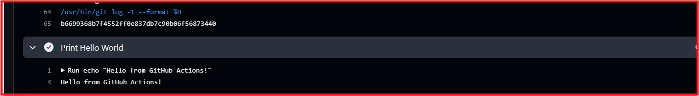
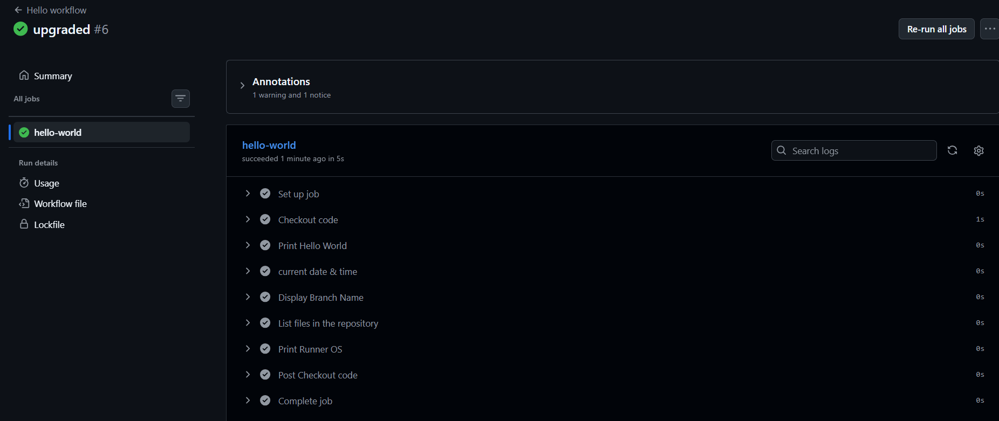
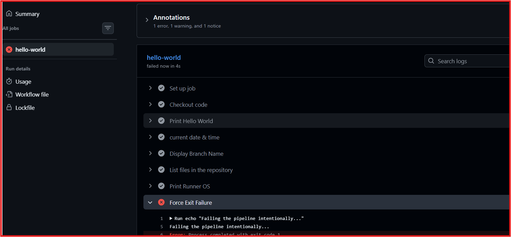
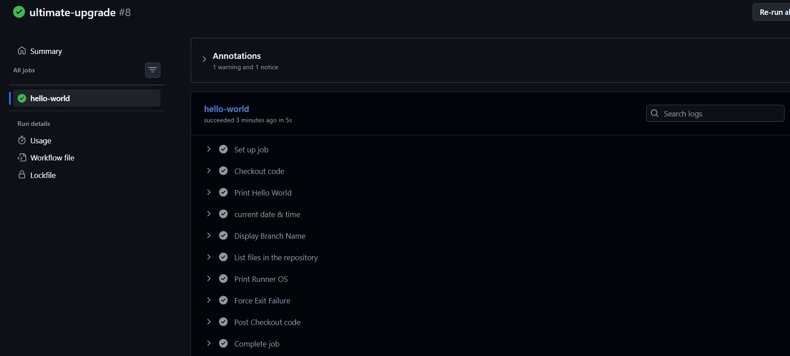

# Day 40 – Your First GitHub Actions Workflow 🚀
📌 Overview

- Implemented my first GitHub Actions CI workflow to understand how automated workflows execute in a cloud-hosted runner environment.

**This hands-on task covers workflow triggers, job execution, shell commands, GitHub context variables, and pipeline failure handling.**

## 🎯 Objectives

- Create a GitHub Actions workflow triggered by every push.
- Understand workflow structure and execution.
- Inspect branch information, repository files, and runner environment.
- Simulate a pipeline failure, analyze the error, and validate the fix.

# Task 1: Repository Setup
- Created a public GitHub repository named github-actions-practice.
- Cloned the repository locally.
- Created the .github/workflows/ directory to store workflow configuration files.

> **GitHub Actions Practice Repository:**  
> [Click here to view the repository](https://github.com/chaitanyakolse738-art/github-action-practice)

# Task 2: Create the Hello Workflow

- Created .github/workflows/hello.yml with the following configuration:
- Configured the workflow to trigger on every push.
- Executed the  Hello-world job on an Ubuntu runner.
- Verified the workflow execution and reviewed the step logs in the GitHub Actions tab.

# Task 3: Understand the Workflow Structure
**Key	Description**

- on: Defines the event that triggers the workflow.
- jobs:	Defines the jobs to execute.
- runs-on: Specifies the runner environment.
- steps: Defines the sequence of actions and commands.
- uses:	Executes a reusable GitHub Action.
- run:	Executes shell commands on the runner.
- name:	Assigns a descriptive name to a workflow, job, or step.

# Task 4: Add Environment Inspection Steps

* Updated the workflow to include the following steps:

- Date and Time: Displayed the current date and time using date.
- Branch Information: Displayed the triggering branch using ${{ github.ref_name }}.
- Repository Files: Listed repository contents using ls -la.
- Runner Operating System: Displayed the runner OS using $RUNNER_OS.

- Pushed the changes and verified the updated workflow execution.

# Task 5: Simulate and Fix a Pipeline Failure
- Introduced an intentional failure using the exit 1 command.
- Pushed the change and inspected the failed workflow run and step logs.
- Identified the failure through the step's error status and non-zero exit code.
- Removed the failing command and pushed the fix.
- Verified the subsequent workflow run.

- Key Learning: Failed steps and their logs help identify errors, while a corrected commit triggers a new run to validate the fix.

# Outcome

**Successfully explored GitHub Actions fundamentals, including workflow configuration, push triggers, runner environments, execution logs, and failure recovery.**

#90DaysOfDevOps #DevOpsKaJosh #TrainWithShubham #GitHubActions #CICD
