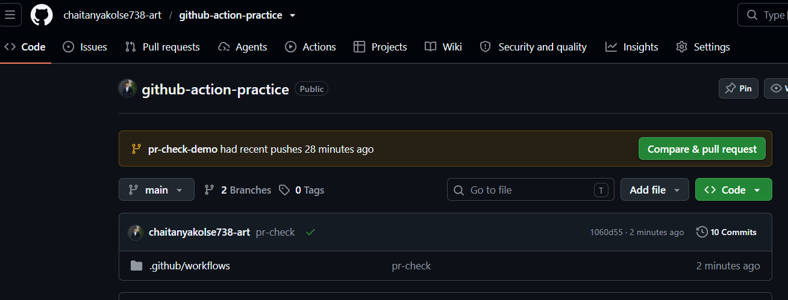
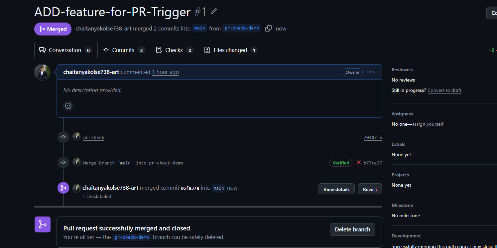
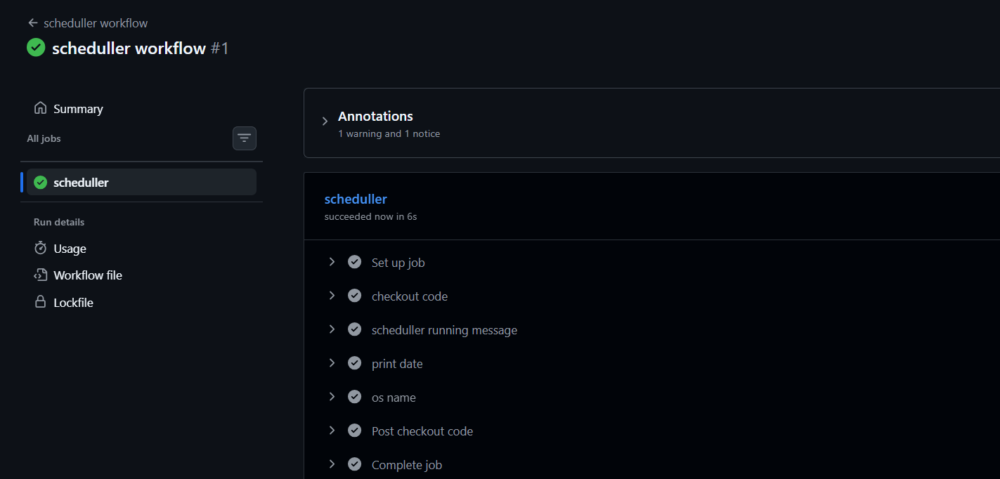
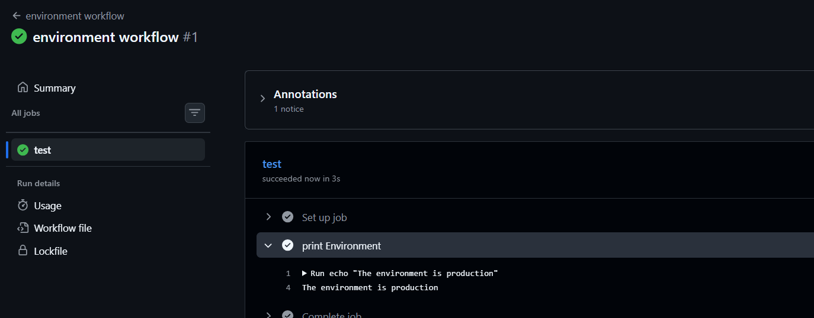
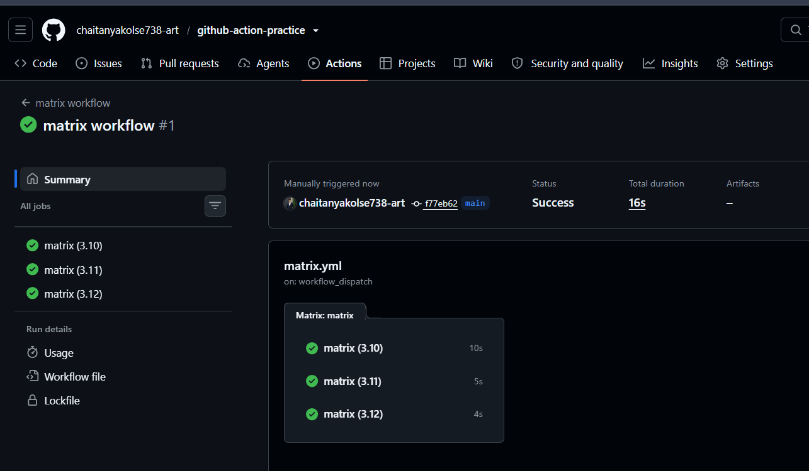
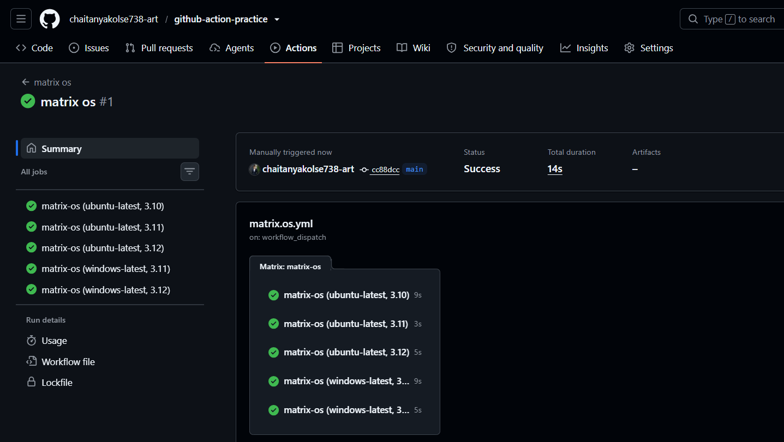
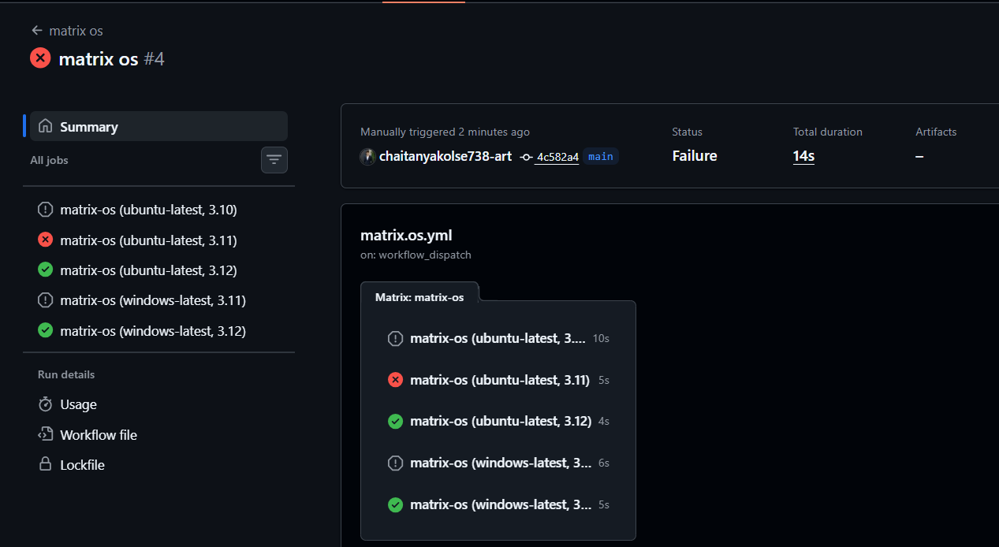

# Day 41 – GitHub Actions: Triggers & Matrix Builds

## Overview
- Today's focus was on understanding GitHub Actions workflow triggers and matrix strategies to automate CI/CD workflows efficiently.

# Task 1: Pull Reqeust Trigger

**Concept: Automatically run a workflow when a pull request is opened or updated against the main branch.**

## Key Learning

- Automates validation during the pull request process.
- Helps detect issues before merging changes.
- Displays workflow results directly on the pull request page

## Verify

> The workflow appears on the Pull Request page and runs successfully.

>  PR Check Workflow:
> [Click here to view the workflow file.](./workflows/pr-check.yml)

*Evidence:*

# Task2. Scheduled Trigger

**Concept: Run workflows automatically at specific times using cron expressions.**

## Key Learning:

- Automates recurring tasks without manual intervention.
- Useful for scheduled checks, maintenance, and periodic automation.
- GitHub Actions uses UTC for scheduled workflow execution.

**Cron Expression: Every Day Midnight at 00:00 AM UTC.*

# Task 3. Manual Trigger

**Concept: Start a workflow manually using the workflow_dispatch trigger.**

## Key Learning:

- Allows on-demand execution without requiring a code push.
- Accepts user-defined inputs, such as the target environment.
- Supports controlled execution for staging and production workflows.

*Evidence:*

# Task 4: Matrix Builds

**Concept: Run the same job across multiple versions or environments using a matrix strategy.**

## Key Learning:

- Tests applications against multiple Python versions.
- Runs independent jobs in parallel when runner capacity allows.
- Reduces the need to maintain separate workflows for each version.
- Combining Python versions with operating systems expands test coverage

## Task 5: Matrix Exclusions and Fail-Fast

**Concept: Control matrix combinations and determine how workflow failures affect other running jobs.**

## Key Learning:

- exclude removes specific combinations from the matrix.
- fail-fast: true cancels in-progress matrix jobs when a matrix job fails.
- fail-fast: false allows the remaining matrix jobs to continue after a failure.
- Matrix configuration helps balance test coverage, execution time, and resource usage.

# Key Takeaways
- Understood event-based, scheduled, and manual workflow triggers.
- Learned how pull request events automate validation before merging.
- Used matrix strategies to test multiple Python versions and operating systems.
- Understood matrix exclusions and fail-fast behavior.
- Improved understanding of automated testing and CI workflow design.

## Conclusion

**GitHub Actions triggers determine when a workflow runs, while matrix strategies determine which combinations of environments execute a job. Together, they make CI pipelines more flexible, scalable, and maintainable.**