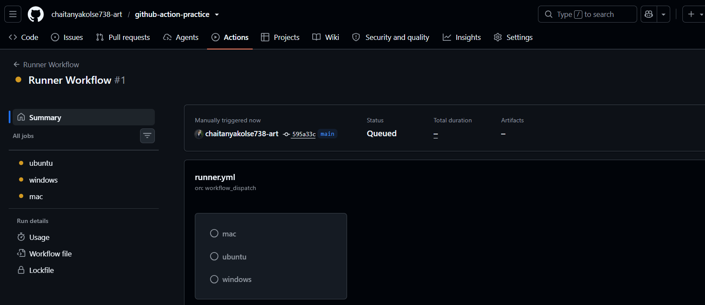
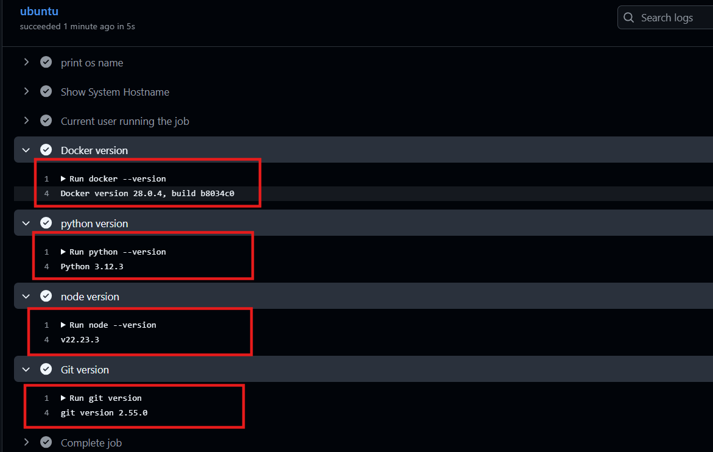
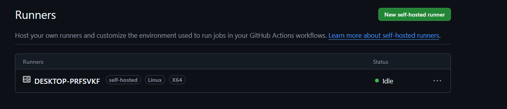
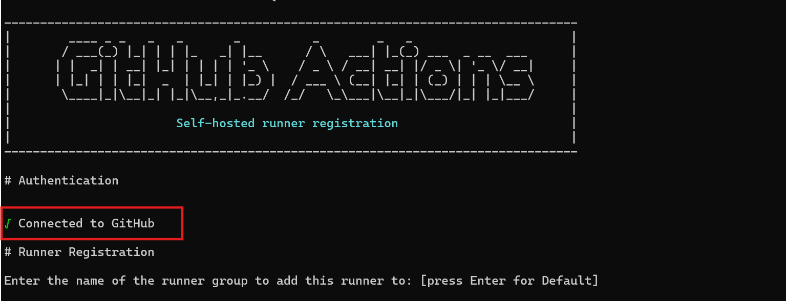
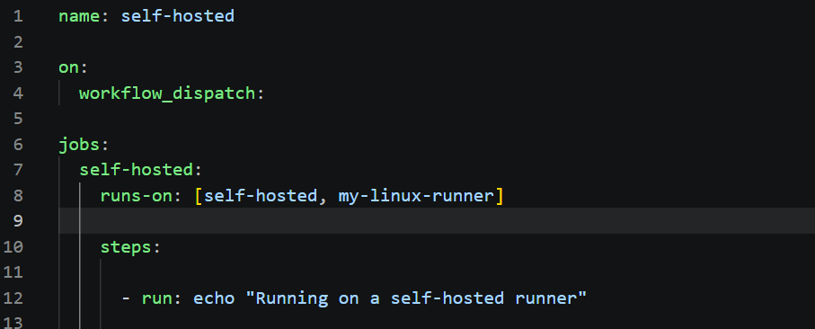

# 42 – GitHub Actions Runners

## Objective

*Understand how GitHub Actions runners execute workflow jobs, explore GitHub-hosted and self-hosted runners, and learn how runner labels control job assignment.*

# Task 1: GitHub-Hosted Runners
- Created a workflow with three jobs targeting Ubuntu, Windows, and macOS.
- Printed the operating system, hostname, and current user for each job.
- Observed jobs running in parallel.

**Learning: GitHub manages the runner infrastructure and provides separate execution environments for jobs.**

# Task 2: Explore Pre-Installed Software

- Checked Docker, Python, Node.js, and Git versions on the Ubuntu runner.
- Explored the official documentation for pre-installed runner software.
- Learning: Pre-installed tools reduce setup time and simplify CI/CD workflows. Checking versions  helps maintain consistent builds.

# Task 3: Set Up a Self-Hosted Runner

- Registered a self-hosted runner with my GitHub repository.
- Configured and started the runner on my local machine.
- Verified that the runner appeared online and showed an Idle status.
- Learning: A self-hosted runner uses infrastructure that I manage and must be online to receive jobs

# Task 4: Execute a Workflow on a Self-Hosted Runner

- Created a workflow targeting runs-on: self-hosted.
- Verified the machine hostname and working directory.
- Created a file and checked its existence on the machine.
- Learning: GitHub assigns a job to an eligible, available runner, which executes the job on its own machine.

# Task 5: Runner Labels

- Added a custom label to the self-hosted runner.
- Updated the workflow to target self-hosted and my-linux-runner.
- Verified that the workflow was assigned to a runner matching both labels.
- Learning: Labels help target specific runners when multiple machines are registered

## Task 6: GitHub-Hosted vs Self-Hosted

| Feature | GitHub-Hosted | Self-Hosted |
|--------|--------|--------|
| Who manages it? | GitHub | You |
| Cost | Free minutes (or billed usage) | Your infrastructure cost |
| Pre-installed tools | Yes | Depends on your setup |
| Good for | Standard CI/CD workflows | Custom or dedicated workloads |
| Security concern | Managed by GitHub | Your responsibility |
