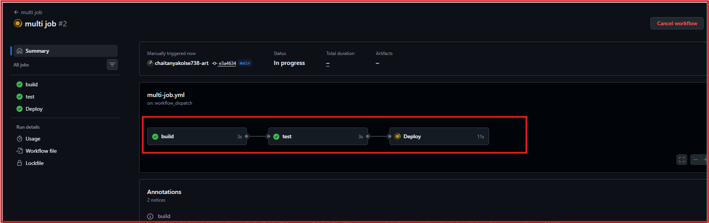
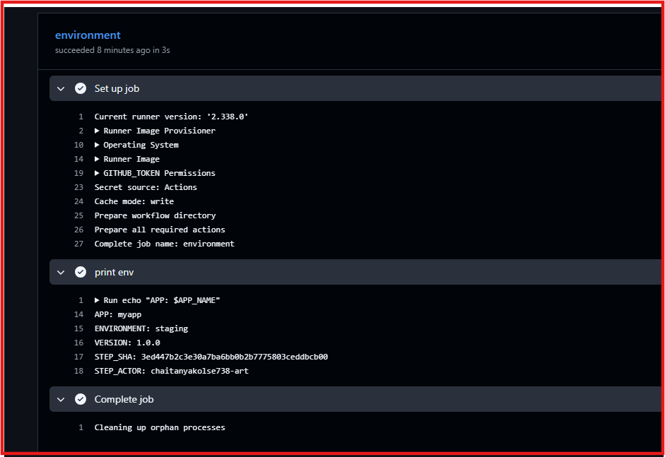
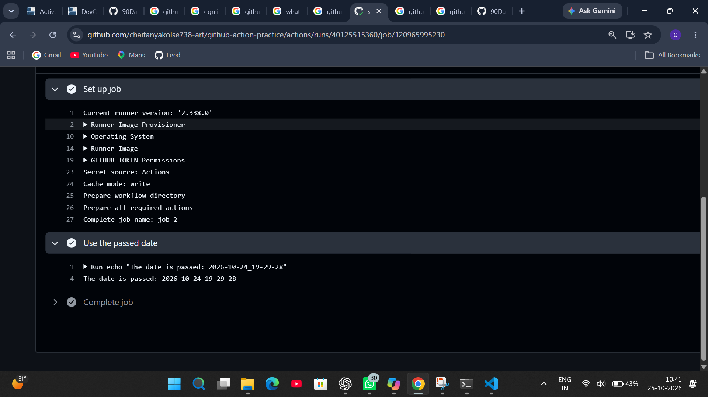
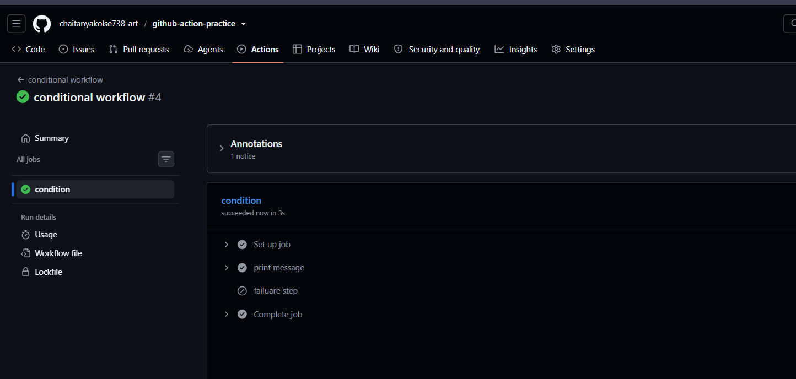
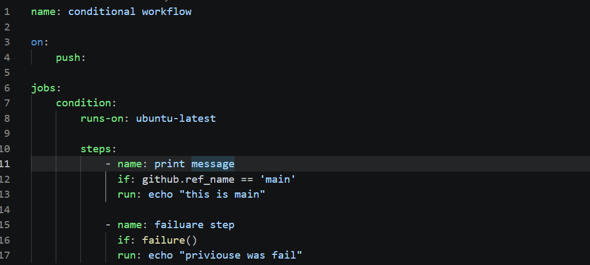
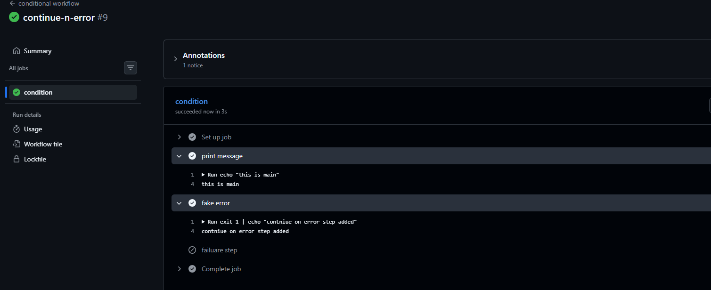

# Day 43 – Jobs, Steps, Env Vars & Conditionals

## Objective

- Understand how GitHub Actions controls workflow execution using job dependencies, environment variables, job outputs, and conditional execution.

# Task 1: Multi-Job Workflow

- Created a workflow with three jobs: build, test, and deploy.
- Configured job dependencies so that test runs after build succeeds and deploy runs after test succeeds.
- Verified the job dependency chain using the workflow graph in the Actions tab.

**Learning: The needs keyword controls job execution order and ensures dependent jobs wait for their required jobs to succeed**

# Task 2: Environment Variables

- Configured environment variables at workflow, job, and step levels.
- Verified that the variables were accessible within the appropriate scope.
- Used GitHub context variables to display the commit SHA and the actor who triggered the workflow.

**Learning: Environment variables can be defined at different levels, while GitHub context variables provide information about a workflow run.**

# Task 3: Job Outputs

- Created a job that generates a value and exposes it as an output.
- Passed the output to a second job using job outputs and dependencies.
- Verified that the receiving job could access and print the value.

**Learning: Job outputs allow jobs to share data when they run in separate execution environments.**

# Task 4: Conditionals

- Configured a step to run only on the main branch.
Added a step that runs when a previous step fails.
- Configured a job to run only for push events, excluding pull request events.
- Tested continue-on-error to understand how a workflow handles a failed step without stopping the job.

**Learning: Conditions control when jobs and steps run, while continue-on-error allows execution 
to continue after a step failure**

# Task 5: Smart Pipeline

- Created a smart pipeline that triggers on pushes to any branch.
- Configured lint and test jobs to run in parallel.
Added a summary job that depends on both jobs.
- Configured the summary to identify whether the push occurred on main or a feature branch and display the commit message.

**Learning: Combining parallel jobs, dependencies, and conditional logic helps build organized and automated CI/CD workflows.**

