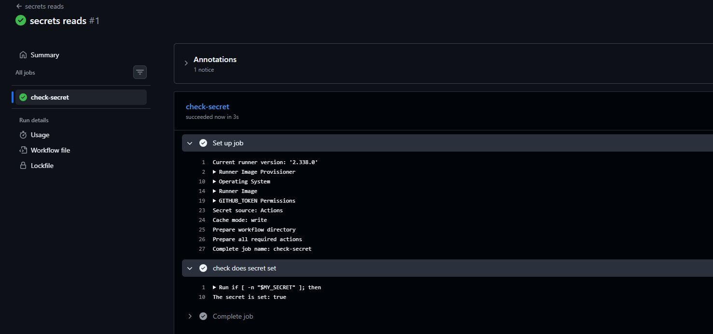
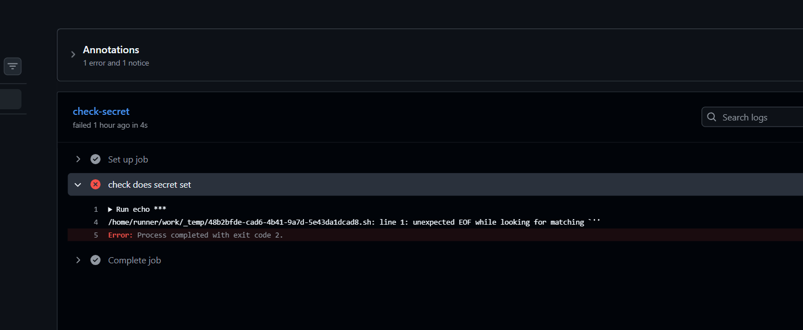
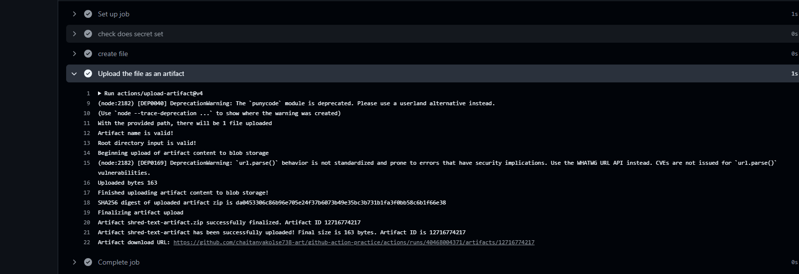
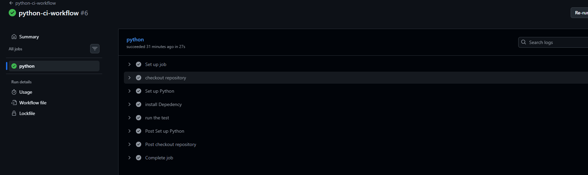
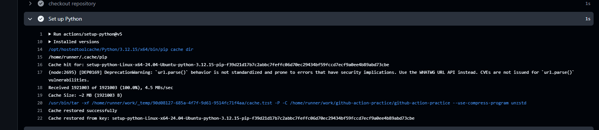

# Day 44 – GitHub Actions: Secrets, Artifacts & Caching

## Objective

* Learn secure secret management in GitHub Actions.
* Understand artifact storage and sharing between jobs.
* Implement automated testing and dependency caching in CI pipelines.

## Task 1: GitHub Secrets

* Learned to store sensitive values securely in GitHub repository settings.
* Understood how workflows access secrets without hardcoding credentials.
* Identified safe handling of secrets in CI/CD pipelines.

## Task 2: Environment Variables

* Learned how to pass secrets to workflow steps through environment variables.
* Identified `DOCKER_USERNAME` and `DOCKER_TOKEN` for Docker Hub authentication.
* Understood the importance of preventing sensitive values from appearing in logs.

## Task 3: Uploading and Sharing Artifacts

* Learned how to upload workflow-generated files using GitHub Actions artifacts.
* Understood how artifacts can be downloaded after a workflow completes.
* Explored sharing build outputs and test reports between jobs.

## Task 4: Automated Testing with Python

* Configured a GitHub Actions workflow using Python 3.12.
* Installed dependencies from `python/requirements.txt`.
* Executed automated tests using `pytest`.
* Verified dependency cache restoration through workflow logs.

## Task 5: Dependency Caching

* Enabled pip caching using `actions/setup-python`.
* Configured `cache-dependency-path` to track `python/requirements.txt`.
* Verified that GitHub Actions restored the dependency cache.
* Learned how caching reduces repeated package downloads.

## Key Takeaways

* **Security:** Protect credentials using GitHub Secrets.
* **Artifacts:** Preserve and share generated workflow files.
* **Testing:** Detect failures automatically during CI.
* **Caching:** Reduce repeated dependency downloads.

**Learning Track:** 90DaysOfDevOps
**Repository:** `github-action-practice`
**Focus:** GitHub Actions | Python CI | Secrets | Artifacts | Caching
