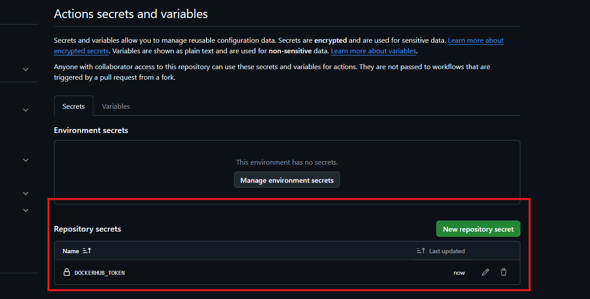
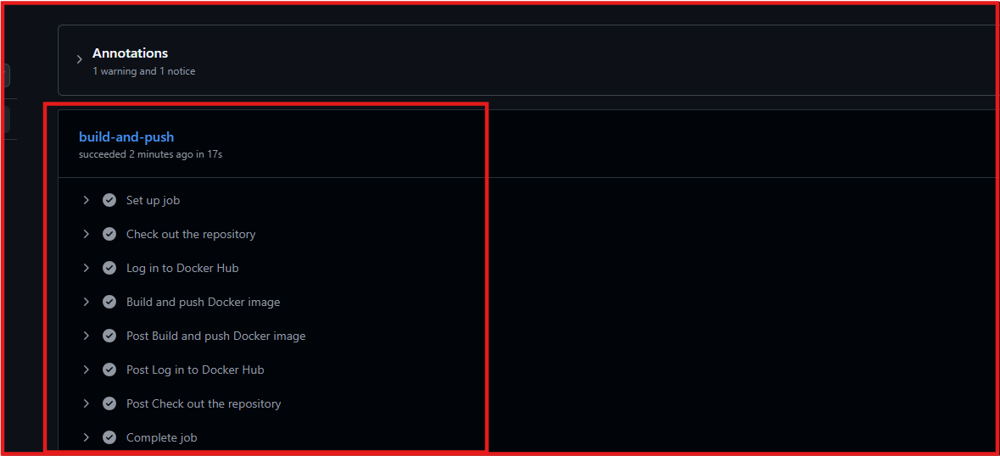
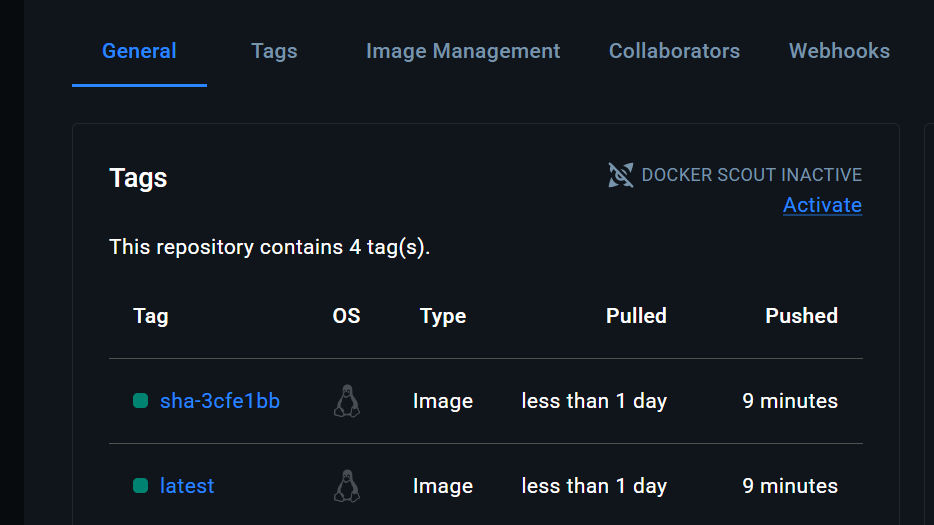
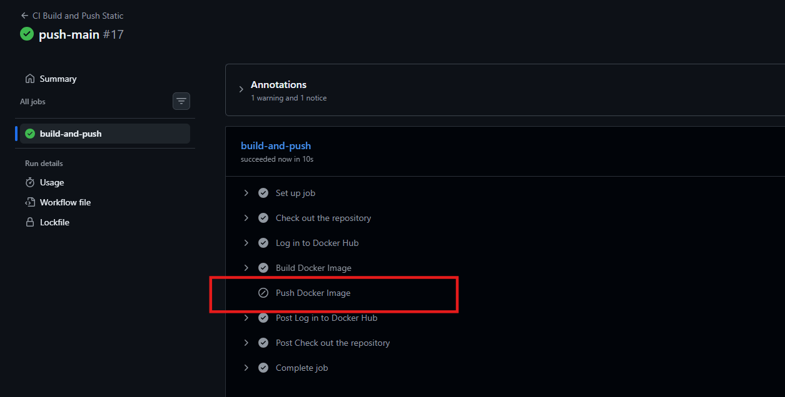
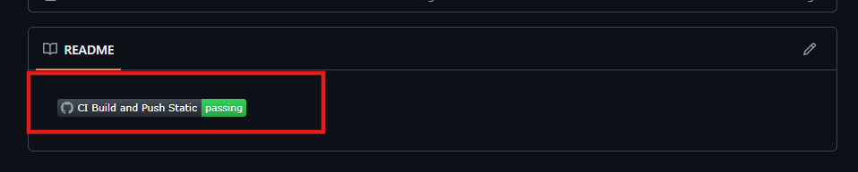
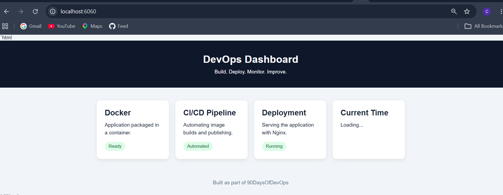

# Day 45 – Docker Build & Push with GitHub Actions

## Objective

Build an automated Docker CI/CD pipeline using GitHub Actions that builds Docker images, authenticates with Docker Hub, and publishes images automatically whenever code is pushed to the `main` branch.

The goal is to understand how Docker image building and publishing are integrated into a real-world CI/CD workflow.

---

## Task 1 – Project Preparation

* Use the application developed during Day 36 or another application with a valid Dockerfile.
* Prepare the project structure inside the `github-actions-practice` repository.
* Configure Docker Hub credentials using GitHub Actions repository secrets.
* Verify that the required Docker Hub credentials are available securely.

## Task 2 – Docker Image Build Automation

* Create a GitHub Actions workflow named `docker-publish.yml`.
* Configure the workflow to trigger automatically when code is pushed to the `main` branch.
* Use the checkout action to access the repository source code.
* Configure the Docker build process to generate an image from the project's Dockerfile.
* Verify the image build process through GitHub Actions workflow logs.

## Task 3 – Docker Hub Authentication and Image Publishing

* Integrate Docker Hub authentication using `docker/login-action`.
* Use GitHub repository secrets to authenticate securely without exposing credentials.
* Configure Docker image tagging with two different tags:

  * `latest` – identifies the latest published image.
  * `sha-<commit-hash>` – identifies the image associated with a specific commit.
* Push both image tags to Docker Hub using the Docker build and push action.
* Verify that both tags are available in the Docker Hub repository.

## Task 4 – Branch-Based Publishing Control

* Configure the workflow to allow Docker image publishing only from the `main` branch.
* Ensure that feature branches can execute the image build process without publishing images.
* Prevent Docker Hub publishing during pull request events.
* Verify that branch-based conditions correctly control the publishing process.

## Task 5 – GitHub Actions Status Badge

* Generate a status badge for the Docker publishing workflow.
* Add the badge to the project's `README.md`.
* Use the badge to display the current workflow status.
* Verify that the badge correctly reflects the workflow execution result.

## Task 6 – Docker Image Pull and Container Verification

* Pull the published Docker image from Docker Hub to the local environment.
* Run a container using the published image.
* Verify that the application starts and works as expected.
* Confirm that the published image can be used independently of the GitHub Actions runner.

---

## CI/CD Pipeline Workflow

The complete automation process follows this sequence:

1. **Code Push:** A developer pushes application changes to GitHub.
2. **Workflow Trigger:** GitHub Actions automatically starts the configured workflow.
3. **Source Checkout:** The runner checks out the latest repository code.
4. **Docker Build:** The workflow builds a Docker image using the Dockerfile.
5. **Authentication:** GitHub Actions securely authenticates with Docker Hub.
6. **Image Tagging:** The image receives `latest` and commit-specific tags.
7. **Image Publishing:** Both image tags are pushed to Docker Hub.
8. **Deployment Verification:** The published image is pulled and run in a local or cloud environment.

---

## Expected Deliverables

* [x] Automated GitHub Actions workflow: `.github/workflows/docker-publish.yml`
* [&check;] Successfully built Docker image.
* [&check;] Docker image published to Docker Hub with both tags.
* [&check;] Branch-based publishing conditions.
* [&check;] GitHub Actions workflow status badge in `README.md`.
* [&check;] Successful image pull and container execution.
* [&check;] Pipeline execution screenshot.
* [&check;] Docker Hub repository link.

---

## Key Learning Outcomes

By completing this task, I will understand:

* How to automate Docker image builds using GitHub Actions.
* How to securely manage Docker Hub credentials using GitHub Secrets.
* How to tag Docker images using commit-specific identifiers.
* How to publish Docker images automatically to a container registry.
* How to control CI/CD execution based on Git branches.
* How to monitor pipeline execution using GitHub Actions status badges.
* How to pull and run published Docker images outside the CI/CD environment.

---

**Challenge:** Build a complete automated pipeline that connects GitHub, GitHub Actions, Docker, and Docker Hub, eliminating the need for manual Docker image building and publishing.
