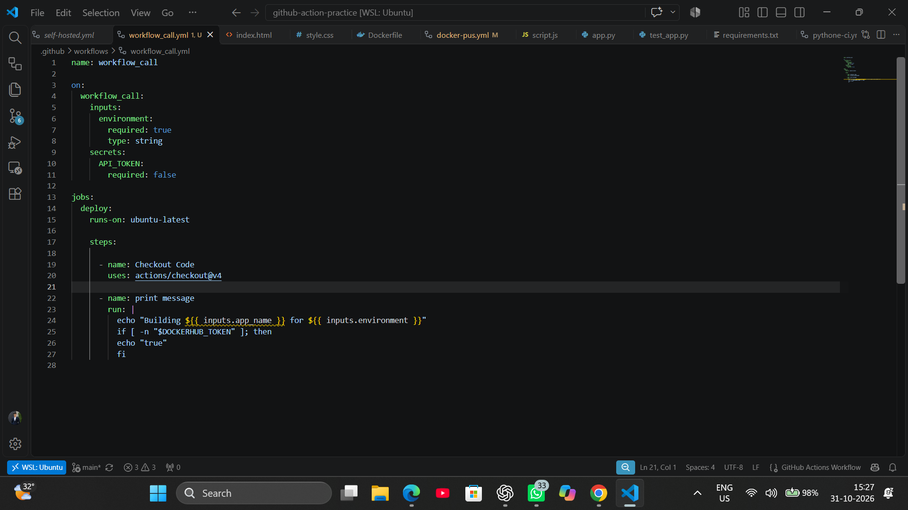
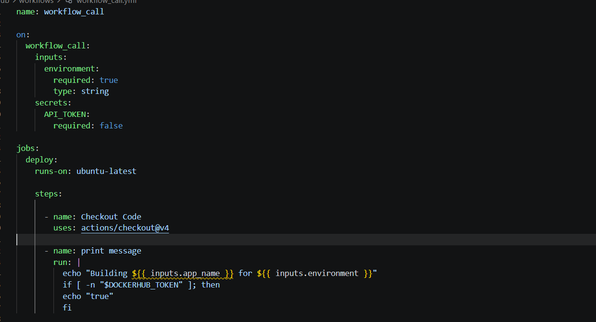
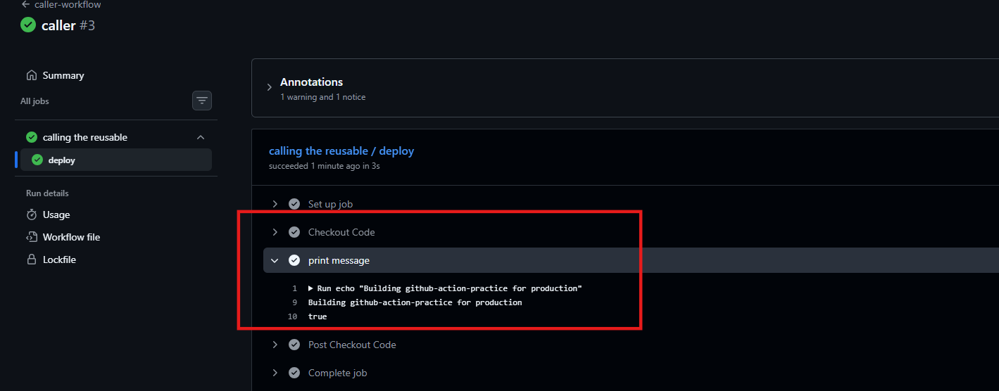
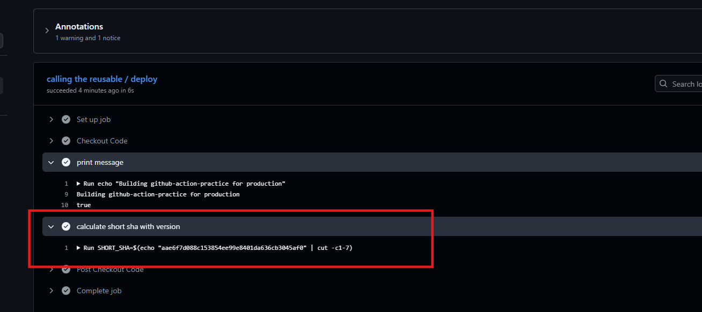
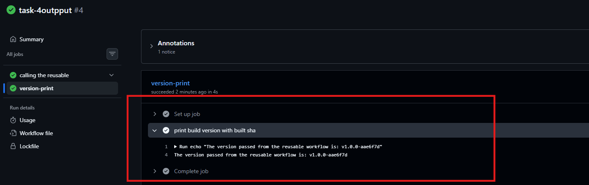
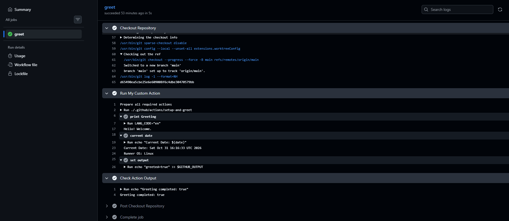

# Day 46 – Reusable Workflows & Composite Actions

## Objective

Learn how to reuse GitHub Actions workflows and steps to avoid repeated code and build maintainable CI/CD pipelines.

## Task 1: Understand `workflow_call`

* Learned what reusable workflows are and how they work.
* Understood the `workflow_call` trigger.
* Learned the difference between calling a reusable workflow and a regular action.
* Identified `.github/workflows/` as the required location for reusable workflows.

## Task 2: Create a Reusable Workflow

* Created `reusable-build.yml` using `workflow_call`.
* Defined inputs for application name and environment.
* Configured a required Docker secret.
* Added steps to check out code, display build information, and verify the secret without exposing its value.

## Task 3: Create a Caller Workflow

* Created `call-build.yml` with a push trigger on `main`.
* Called the reusable workflow using `uses`.
* Passed application details through `with`.
* Passed the Docker token securely through `secrets`.

## Task 4: Add Outputs

* Generated a unique build version using the Git commit SHA.
* Configured step and job outputs.
* Exposed the build version through the reusable workflow.
* Used `needs` to access and display the output in another job.

## Task 5: Create a Composite Action

* Created a custom action at `.github/actions/setup-and-greet/action.yml`.
* Defined `name` and `language` inputs.
* Added greeting, date, and runner OS steps.
* Created and exposed a `greeted` output.
* Used the custom action in a separate workflow.

## Task 6: Reusable Workflow vs Composite Action

| Comparison               | Reusable Workflow     | Composite Action       |
| ------------------------ | --------------------- | ---------------------- |
| Called using             | `workflow_call`       | `uses:`                |
| Can contain jobs?        | Yes                   | No                     |
| Can contain steps?       | Yes                   | Yes                    |
| Location                 | `.github/workflows/`  | `.github/actions/`     |
| Accept secrets directly? | Yes                   | No                     |
| Best for                 | Reusing complete jobs | Reusing multiple steps |

## Key Learning

* Reusable workflows help share complete jobs or multiple jobs across workflows.
* Composite actions help group and reuse steps inside existing jobs.
* Both reduce code duplication and improve CI/CD maintainability.

## Submission

* [x] Save documentation in `2026/day-46/day-46-reusable-workflows.md`.
* [x] Verify reusable workflow execution.
* [x] Verify composite action execution.
* [x] Add the required screenshot.
* [x] Commit and push changes to GitHub.
